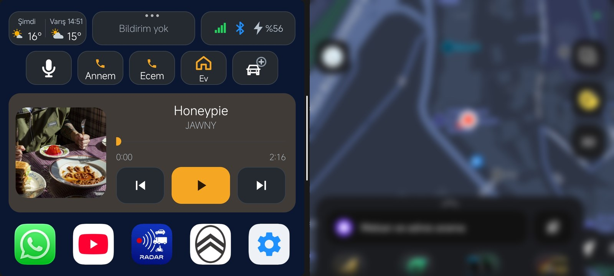

# Kopilot

Arabada telefonu tek ekrandan kullanmak için Android uygulaması. Harita yanda açık dururken müzik, aramalar, hızlı rotalar, hava durumu ve mesajlar büyük düğmelerle hep elinin altında.

## İndir

**[Kopilot'u indir (APK)](https://github.com/ekererdem/surus-ekrani/releases/download/latest/SurusEkrani.apk)**

Android 11 ve üstü telefonlarda çalışır. Kurarken telefon "bilinmeyen kaynaklardan yükleme" izni ister; Play Store dışından kurulan uygulamalar için bu normaldir.

## Neler yapar

- **Arabaya binince hazır:** Araba Bluetooth'una bağlanınca kendiliğinden açılır, müziği kaldığı yerden çalar, sesi senin seçtiğin seviyeye getirir.
- **Harita yanda:** Google Maps ya da Yandex Haritalar ekranın diğer yarısında açılır. Hızlı rota düğmeleriyle eve, işe tek dokunuşla yola çıkarsın.
- **Hava durumu:** Şu an, bir saat sonra ya da varış saatindeki hava. Yağmur, kar, sis ya da fırtına bekleniyorsa renkli çerçeveyle uyarır. Dokununca önümüzdeki 6 saat.
- **Bildirim kutusu:** Seçtiğin uygulamaların mesajları ana ekranda toplanır, telefonun yukarıdan inen bildirimi haritanın önünü kapatmaz.
- **Hızlı arama:** En sık aradığın kişiler tek dokunuşta. Basılı tutarsan WhatsApp'tan konumunu gönderirsin.
- **Arabam nerede:** Arabadan inmeden park yerini kaydet, sonra yürüyerek kolayca bul.
- **Bluetooth:** Kopilot açılınca Bluetooth'u açar, arabadan inince kapatır.
- **El sallayarak kontrol:** Elini ön kameranın üzerinden geçir; şarkı geçsin, müzik dursun.

## İlk kurulum

1. Kopilot'u aç ve kısa tanıtımı geç.
2. **Ayarlar › Araba ve Bluetooth** bölümünden arabanın Bluetooth adını seç.
3. **Ayarlar › İzinler** bölümünde kapalı görünen izinlere dokunup aç.
4. Hızlı arama ve hızlı rotalara kişilerini ve yerlerini ekle.

## Kendin derlemek istersen

Projeyi Android Studio'da aç, **Build › Build APK(s)** de. Bu depoda her değişiklikten sonra GitHub Actions APK'yı kendisi derleyip yukarıdaki indirme bağlantısına koyar.
