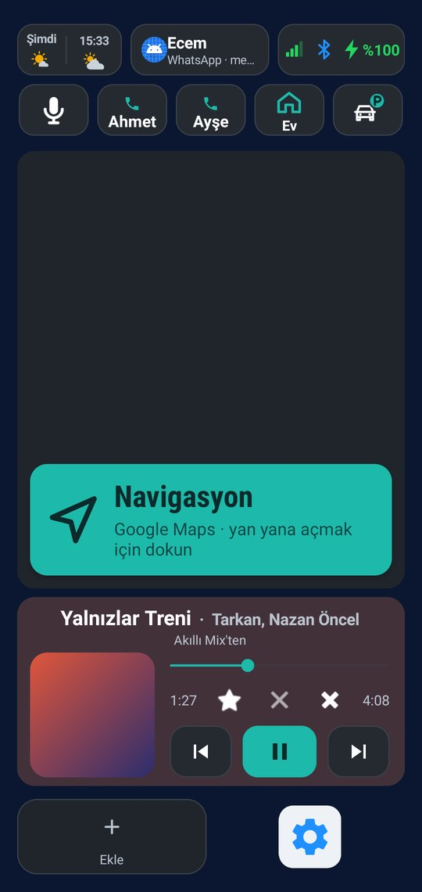
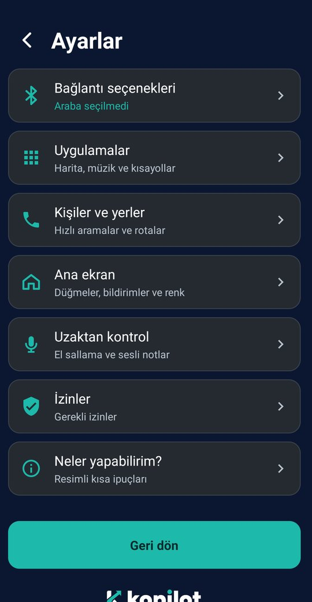
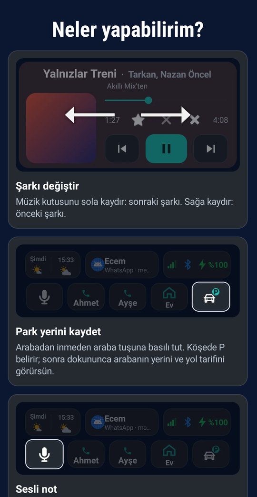

  <picture>
    <source media="(prefers-color-scheme: dark)" srcset="docs/logo-koyu.png">
    
  </picture>

<b>Arabada telefonun için sade bir sürüş ekranı.</b> 
Harita yanda açık dururken müzik, aramalar, rotalar, hava durumu ve mesajlar büyük düğmelerle hep elinin altında.

  <a href="https://github.com/ekererdem/surus-ekrani/releases/download/latest/SurusEkrani.apk"><b>⬇️ Kopilot'u indir (APK)</b></a>
  &nbsp;·&nbsp; Android 11 ve üstü &nbsp;·&nbsp; Ücretsiz, reklamsız

<table>
  <tr>
    <td align="center"> Ana ekran</td>
    <td align="center"> Ayarlar</td>
    <td align="center"> Neler yapabilirim?</td>
  </tr>
</table>

## Neler yapar

### 🚗 Arabaya binince hazır
- **Kendiliğinden açılır.** Arabanın Bluetooth'una bağlanınca Kopilot açılır, müzik kaldığı yerden devam eder, ses seçtiğin seviyeye gelir.
- **Harita yanda.** Google Haritalar ya da Yandex Haritalar ekranın diğer yarısında kendiliğinden açılır.
- **Bluetooth'u düşünmezsin.** Kopilot açılınca Bluetooth açılır, arabadan inince kapanır. Kulaklık ya da saat bağlıysa dokunmaz.

### 🗺️ Yolda
- **Tek dokunuşla rota.** Ev, iş gibi yerlerine dokun, rota hemen başlasın; adres yazmana gerek kalmaz.
- **Hava durumu.** Şimdi ve 1 saat sonrası. Hava bozacaksa renkli çerçeveyle önceden uyarır; dokununca önümüzdeki 6 saat.
- **Arabam nerede.** Arabadan inmeden park yerini kaydet; sonra arabanın ne kadar uzakta olduğunu gör, yürüyerek yol tarifi al.

### 🎵 Müzik
- **Spotify ve YouTube Music.** Büyük tuşlar, şarkının adı ve nereden çaldığı ("Beğenilen Şarkılar'dan", "Akıllı Mix'ten").
- **Spotify'ın kendi tuşları.** Beğen, akıllı karıştır, tekrar — Spotify'ı açmadan.
- **Kaydırarak şarkı değiştir.** Müzik kutusunu sola kaydır: sonraki, sağa: önceki.

### 💬 Aramalar ve mesajlar
- **Bildirim kutusu.** Seçtiğin uygulamaların mesajları ana ekranda toplanır; yeni mesaj birkaç saniye altta görünür, haritanın önünü kapatmaz.
- **Hızlı arama.** En sık aradığın kişiler tek dokunuşta. Basılı tutarsan WhatsApp'tan anlık konumunu gönderirsin.
- **Cevapsız arama.** Arayanın adıyla bir düğme belirir; tek dokunuşla geri ararsın.
- **Sesli komut ve sesli not.** Elini direksiyondan ayırmadan ara, mesaj gönder ya da aklına geleni not al.

### 👋 Dokunmadan
- **El salla.** Elini ön kameranın üzerinden geçir: şarkı geçsin, bildirimler görünsün ya da eve rota başlasın.

### 🎨 Sana göre
- Düğmeleri gizle, sırala, üst ya da alt sıraya al. Altı renk seçeneği, ekran ölçeği ve en sık kullandığın 4 uygulamaya kısayol.

## Kurulum

1. **[APK'yı indir](https://github.com/ekererdem/surus-ekrani/releases/download/latest/SurusEkrani.apk)** ve aç. Telefon "bilinmeyen kaynaklardan yükleme" izni ister; Play Store dışından kurulan uygulamalarda bu normaldir.
2. Kopilot'u aç ve kısa tanıtımı geç.
3. **Ayarlar › Bağlantı seçenekleri**'nden arabanı seç. Araban listede yoksa yakındaki cihazlar arasından bulup eşleştirebilirsin.
4. **Ayarlar › İzinler**'de kapalı görünen izinlere dokunup aç.
5. **Ayarlar › Kişiler ve yerler**'e hızlı arama kişilerini ve sık gittiğin yerleri ekle.

Nasıl kullanılacağını **Ayarlar › Neler yapabilirim?** sayfasında resimli kısa ipuçlarıyla görebilirsin.

## Güncellemeler

Yeni sürüm çıkınca ana ekrandaki Ayarlar simgesinde küçük bir **"Yeni sürüm var"** etiketi belirir. Ayarlar'ın en üstündeki **Güncelle**'ye basman yeter; Kopilot yeni sürümü kendisi indirir, telefon yalnızca onay ister.

## Gizlilik

Hesap yok, reklam yok, takip yok. Kişilerin, yerlerin ve notların yalnızca telefonunda durur. Kopilot internete yalnızca şunlar için çıkar:

- Hava durumu: [Open-Meteo](https://open-meteo.com) (yaklaşık konum)
- Varış süresi tahmini: [OSRM](https://project-osrm.org)
- Yer seçerken harita ve adres arama: [OpenStreetMap](https://www.openstreetmap.org)
- Yeni sürüm kontrolü: GitHub

## Kendin derlemek istersen

Projeyi Android Studio'da aç ve **Build › Build APK(s)** de. Bu depoda her değişiklikten sonra GitHub Actions APK'yı kendisi derleyip yukarıdaki indirme bağlantısına koyar.
